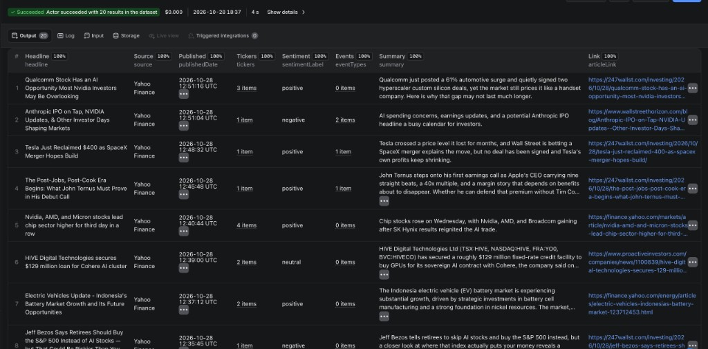
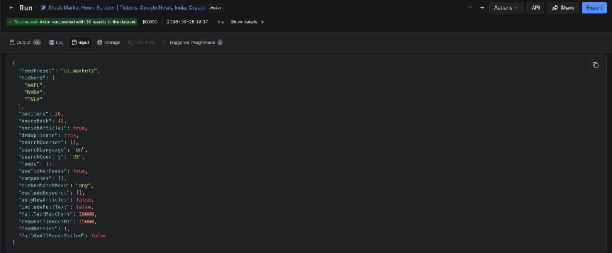
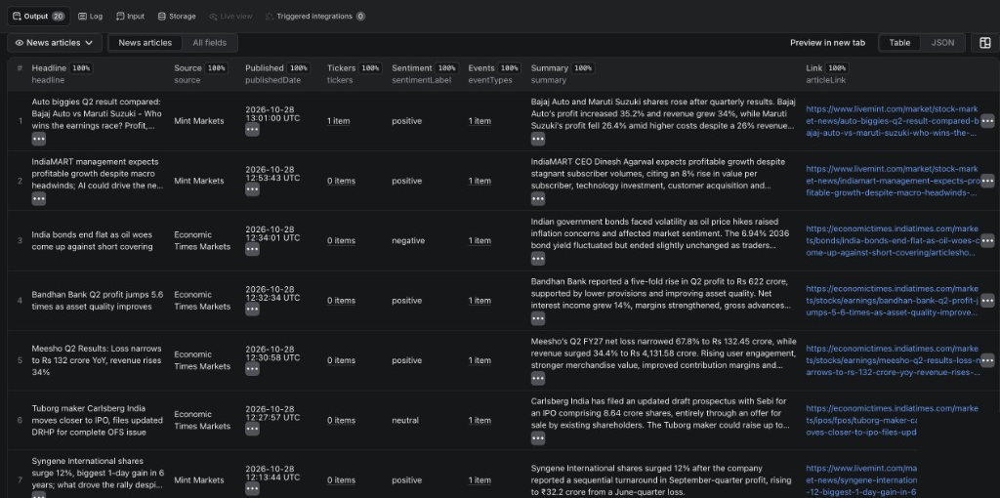

## Stock Market News Scraper | Tickers, Google News, India, Crypto

Need finance headlines as **structured JSON** without maintaining scrapers for every publisher?

**Use it for:**

1. **Watchlist alerts** — schedule with tickers and `onlyNewArticles` so you only get new headlines
2. **Any company or topic** — Google News search by query, country, and language
3. **India / crypto / US markets** — curated presets for dashboards, sentiment triage, and AI/RAG

### Start in 30 seconds

1. Leave the default **US markets** prefill (`us_markets`, 50 items, last 24 hours) — or switch to India / crypto
2. Click **Start**
3. Open the **Output** tab for headlines with `tickers`, `sentimentLabel`, and `eventTypes`

> **Tip — zero results?** An explicit `includeKeywords` list or a short `hoursBack` window often filters everything out. Clear keywords (or set `[]`) and keep `useTickerFeeds` on when using tickers. When `count` is 0, check `OUTPUT.runStatus` (`no_items`, `no_new_items`, `all_feeds_failed`, …) — the run still succeeds by default.

**What this is:** Public **RSS feeds + Google News** → JSON. Headlines and metadata from sources that include MarketWatch, CNBC, Yahoo Finance, Economic Times, Mint, and crypto outlets — **not** paywalled full text from Bloomberg, WSJ, or FT. Optional `includeFullText` works only on non-paywalled pages.

Sentiment and event tags are best-effort, rule-based signals — **not investment advice**.

→ [Try the Actor on Apify](https://apify.com/vamsi-krishna/stock-market-news-collector)

## Screenshots

**Output (tickers/sentiment)**



**Input (watchlist)**



**India markets output**



## For AI agents

This Actor is designed for MCP and API discovery:

- **Search terms:** stock market news, company news API, ticker news, Google News finance, India stock news, crypto news, financial news sentiment
- **Apify username:** `vamsi-krishna`
- **Actor name:** `stock-market-news-collector`
- **Full Actor ID:** `vamsi-krishna/stock-market-news-collector`
- **Primary output:** dataset items (`headline`, `articleLink`, `tickers`, `publishedDate`, `sentimentLabel`, `eventTypes`)
- **Run outcome:** succeeds by default — check `OUTPUT.runStatus` when `count` is 0
- **Agent guide:** see [AGENTS.md](./AGENTS.md) for input recipes, output fields, and common mistakes

Apify MCP `fetch-actor-details` returns input schema, output schema, dataset field examples, and this README.

## What you get

Each article in the dataset:

```json
{
  "headline": "Why Nvidia's stock is dodging the AI credit scare crushing Broadcom and Oracle",
  "source": "MarketWatch Breaking News",
  "author": null,
  "publishedDate": "2026-10-10T20:06:24.000Z",
  "articleLink": "https://www.marketwatch.com/story/...",
  "summary": "Nvidia has held up better than other AI names...",
  "categories": [],
  "imageUrl": "https://...",
  "tickers": ["NVDA", "AVGO", "ORCL"],
  "companyDetails": [
    { "ticker": "NVDA", "name": "Nvidia Corp.", "exchange": "NASDAQ", "sector": "Technology" }
  ],
  "eventTypes": [],
  "sentimentScore": 0,
  "sentimentLabel": "neutral",
  "dedupeKey": "https://www.marketwatch.com/story/...",
  "sourceFeed": "https://feeds.content.dowjones.io/public/rss/mw_bulletins",
  "searchQuery": null,
  "fetchedAt": "2026-10-11T07:30:00.000Z"
}
```

With `includeFullText: true`, articles also get `fullText` and `fullTextStatus`.

Each run also produces a **run summary** in the Output tab: feed stats, failures, and `runStatus` (`ok`, `partial`, `no_items`, `no_new_items`, `all_feeds_failed`, or `error`).

## Use cases

- **Watchlist alerts** — schedule a run every 15 minutes with `tickers` and `onlyNewArticles`, then send new items to Slack, Discord, Telegram, or email
- **Company and topic monitoring** — Google News search for any company, product, or theme, in any country and language
- **India and crypto coverage** — dedicated presets for Economic Times, Mint, CoinDesk, Cointelegraph, Decrypt, and The Block
- **Sentiment and event pipelines** — sentiment score and event tags (earnings, M&A, analyst ratings, lawsuits, ...) on every article
- **AI and RAG datasets** — structured news with optional full article text

## How to use this stock market news scraper

1. Choose a **Feed preset**, add **Google News search queries**, or both.
2. Optionally set **Stock tickers**, **Company names**, or **Include keywords**.
3. For scheduled alerts, turn on **Only new articles**.
4. Click **Start** — results appear in the Output tab within seconds. Download as JSON, CSV, or Excel, or use the [Apify API](https://docs.apify.com/api/v2).

### Watchlist alert (schedule every 15–60 minutes)

Each ticker pulls its own Yahoo Finance headline feed, and company names like "Apple" or "Nvidia" also count as a ticker match in the preset feeds. With `onlyNewArticles`, each run returns only headlines you haven't received yet.

```json
{
  "feedPreset": "us_markets",
  "tickers": ["AAPL", "NVDA", "TSLA"],
  "onlyNewArticles": true,
  "hoursBack": 24
}
```

Negative earnings-only alert:

```json
{
  "feedPreset": "us_markets",
  "tickers": ["AAPL"],
  "onlyNewArticles": true,
  "filterEventTypes": ["earnings"],
  "maxSentimentScore": -0.1
}
```

Lean Zapier / Slack payload (fewer fields):

```json
{
  "feedPreset": "us_markets",
  "maxItems": 30,
  "hoursBack": 24,
  "outputFields": ["tickers", "sentimentLabel", "publishedDate"]
}
```

(`headline`, `articleLink`, `source`, and `fetchedAt` are always included so the dataset schema stays valid.)

30-day research backfill:

```json
{ "feedPreset": "us_markets", "maxItems": 100, "hoursBack": 720 }
```

### Google News search, any company or country

```json
{
  "feedPreset": "none",
  "searchQueries": ["Reliance Industries", "Infosys"],
  "searchLanguage": "en",
  "searchCountry": "IN",
  "maxItems": 50
}
```

Google News operators work: `"Apple OR AAPL"`, `"lithium site:reuters.com"`, `"nvidia when:7d"`.

### India markets or crypto

```json
{ "feedPreset": "india_markets", "maxItems": 100 }
```

```json
{ "feedPreset": "crypto", "maxItems": 50, "hoursBack": 48 }
```

### Full article text for RAG

```json
{
  "feedPreset": "none",
  "tickers": ["TSLA"],
  "includeFullText": true,
  "fullTextMaxChars": 10000,
  "maxItems": 20
}
```

### Custom RSS feeds

```json
{
  "feedPreset": "custom",
  "feeds": [{ "name": "My feed", "url": "https://example.com/rss.xml" }],
  "includeKeywords": [],
  "maxItems": 50
}
```

### Apify API (Node.js)

```javascript
import { ApifyClient } from 'apify-client';

const client = new ApifyClient({ token: 'YOUR_APIFY_TOKEN' });
const run = await client.actor('vamsi-krishna/stock-market-news-collector').call({
    tickers: ['AAPL', 'NVDA'],
    onlyNewArticles: true,
});
const { items } = await client.dataset(run.defaultDatasetId).listItems();
console.log(items);
```

## Feed presets

| Preset | Sources | Best for |
| --- | --- | --- |
| `us_markets` (default) | MarketWatch Top Stories, MarketWatch Breaking News, CNBC Investing, Bloomberg Markets | US equities and market headlines |
| `global_markets` | Bloomberg Markets, CNBC International, MarketWatch Top Stories | Broader coverage (English-language sources) |
| `earnings` | CNBC Earnings, CNBC Investing, Bloomberg Markets | Earnings and corporate news |
| `india_markets` | Economic Times, Mint, Business Standard, Hindu Business Line, Moneycontrol, NDTV Profit | Indian equities, Nifty and Sensex |
| `crypto` | CoinDesk, Cointelegraph, Decrypt, The Block | Crypto markets |
| `none` | Nothing | Use only search queries and ticker feeds |
| `custom` | Your own RSS URLs | Any region or publisher |

Search queries and ticker feeds are added on top of any preset.

## Input parameters

| Field | Default | Description |
| --- | --- | --- |
| `feedPreset` | `us_markets` | Feed bundle, `none`, or `custom` |
| `searchQueries` | `[]` | Google News searches (max 10) |
| `searchLanguage` / `searchCountry` | `en` / `US` | Locale for Google News searches |
| `feeds` | `[]` | RSS URLs when preset is `custom` |
| `tickers` | `[]` | Filter by symbols and fetch each symbol's Yahoo Finance feed |
| `useTickerFeeds` | `true` | Fetch per-ticker Yahoo Finance feeds when `tickers` are set |
| `companies` | `[]` | Filter by company name in headline/summary |
| `tickerMatchMode` | `any` | `any` or `all` tickers must match |
| `includeKeywords` | Finance terms (see below) | Match headline + summary; set `[]` to disable |
| `excludeKeywords` | `[]` | Exclude matching articles |
| `hoursBack` | `24` | Only articles from the last N hours (max 720 = 30 days; `0` = no date filter) |
| `maxItems` | `50` | Max articles returned (up to 500) |
| `outputFields` | `[]` | Restrict dataset fields (e.g. for Zapier); empty = all. Always keeps `headline`, `articleLink`, `source`, `fetchedAt` |
| `onlyNewArticles` | `false` | Skip articles returned by earlier runs with the same setup |
| `stateKey` | auto | Optional name for the `onlyNewArticles` history. Stored encrypted. |
| `enrichArticles` | `true` | Add company details, event types, and sentiment |
| `filterEventTypes` | `[]` | Keep articles with at least one of these event types (OR) |
| `minSentimentScore` / `maxSentimentScore` | unset | Inclusive sentiment bounds (-1 to 1); unset disables |
| `includeFullText` | `false` | Fetch and extract the article body |
| `failOnAllFeedsFailed` | `false` | Mark the run FAILED when every feed fails, so monitoring alerts you |

Advanced: `maxItemsPerFeed`, `fullTextMaxChars` (default 10000), `deduplicate` (default true), `requestTimeoutMs` (default 15000), `feedRetries` (default 1).

The built-in finance keywords apply only to the US, global, earnings, and custom presets, and only when you set no tickers, companies, or search queries.

## Enrichment

- **`companyDetails`** — about 85 well-known US and Indian companies are recognized by name or ticker, with exchange and sector
- **`eventTypes`** — `earnings`, `guidance`, `mergers_acquisitions`, `analyst_rating`, `ipo`, `dividends_buybacks`, `legal_regulatory`, `executive_change`, `layoffs_restructuring`, `macro`
- **`sentimentScore`** / **`sentimentLabel`** — finance word-list score from -1 to 1; headline words count double and negations ("won't", "not") flip polarity

Enrichment is rule-based and fast. Treat it as a first-pass signal, not investment advice.

## Only new articles

With `onlyNewArticles: true`, the Actor remembers which articles each setup has returned (for 14 days) in a named key-value store, `stock-market-news-state`, in your account. Runs with the same sources and filters share history, so separate watchlists don't hide each other's news. Set `stateKey` to share or separate history explicitly. That value is stored encrypted. When nothing is new, `runStatus` is `no_new_items` and no articles are charged.

## Reliability

- Runs finish successfully by default — check `runStatus` in the run summary if results look empty, or set `failOnAllFeedsFailed` to get a FAILED run when every feed is down
- Feeds are fetched in parallel; one slow or failed feed does not stop the rest
- Failed feeds are listed in the run summary with error details
- Built-in feeds are health-checked daily
- Articles with missing dates are still included when `hoursBack` is set

## Pricing

Pay a fixed price per article returned, plus a small start fee. Silver subscribers pay 10% less and Gold subscribers pay 20% less. Runs stop at your **maximum cost per run**, and `onlyNewArticles` means scheduled runs don't charge again for headlines you already have.

## Integrations

Schedule runs with Apify, or connect via **Make**, **Zapier**, **n8n**, Slack, and webhooks for automated news monitoring.

## FAQ

### Can I filter news by stock ticker?

Yes. Set `tickers` to symbols like `AAPL` or `RELIANCE.NS`. The Actor adds each ticker's Yahoo Finance headline feed and keeps preset articles that mention the symbol or a known company name.

### Does this cover non-US markets?

Yes. Use the `india_markets` preset, or Google News `searchQueries` with `searchCountry` and `searchLanguage` for any country. `custom` accepts any RSS feed.

### Why do Google News results link to news.google.com?

Google News RSS provides redirect links. They open the original article in a browser; `source` holds the real publisher name. Full text extraction skips these links.

### How do I get all articles without keyword filtering?

Set `includeKeywords` to `[]`.

### Why did I get zero articles?

Check `runStatus`. `no_new_items` means everything was already returned by an earlier run. `no_items` means filters were too strict or `hoursBack` too short. `all_feeds_failed` lists errors in `failures`.

### Is this legal?

The Actor reads public RSS feeds and, optionally, publicly accessible article pages. Verify publisher terms if you redistribute content commercially.

## Limitations

- Full text skips paywalled publishers (Bloomberg, WSJ, FT, Barron's) and some sites block automated requests
- Ticker detection, company recognition, event tags, and sentiment are best-effort
- Google News article links are redirect URLs

Use only feeds and content you are allowed to collect under applicable terms of service.

## Privacy and GDPR

This Actor collects publicly available news headlines and metadata from third-party publishers. It does not scrape personal profiles, login-gated content, or user account data. You are responsible for ensuring your use of collected data complies with applicable privacy laws (including GDPR) and publisher terms of service.

Report bugs or request features via the **Issues** tab on this Actor's Apify Store page or the linked GitHub repository.
